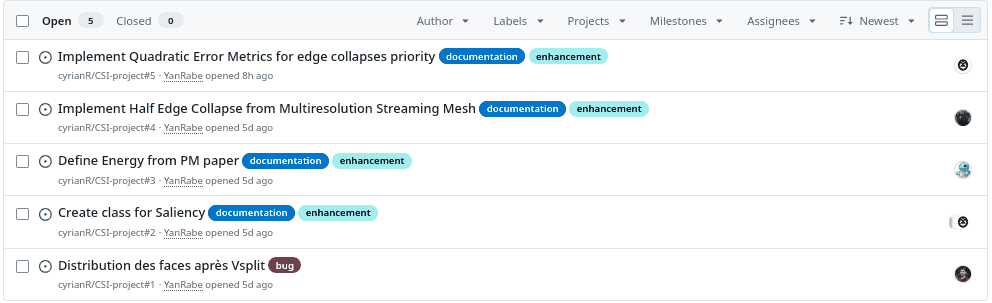

**Note**:

- Ce document a été compilé en pdf en utilisant *pandoc* comme suit :

```bash
cd docs
pandoc midTermReport.md -o midTermReport.pdf --pdf-engine=xelatex --citeproc --highlight-style=tango
```

- L'IA Générative (modèle local Qwen3.6: 27B en utilisant Ollama) a pu y être utilisée pour vérifier la grammaire et la cohérence des liaisons entre les différents propos (Le Stream of Consciousness prend vite de la place).

# Papiers fournis

## Principe initial du Progressive Mesh

Notre équipe base principalement son projet de transmission progressive de maillages 3D sur l'historique papier "**Progressive Meshes**" de Hugues Hoppe. Il y propose la simplification de maillage 3D par "contractions" d'arêtes (*Edge Collapse*), chacune stockée sous forme d'enregistrement réversible (*Vertex Split*). Cela permet la transmission progressive des mesh, selon différents niveaux de détail (*LOD*). En clair, on nous donne un algorithme réversible de simplification d'un maillage 3D (réduction de son niveau de détail par Edge Collapse) à plusieurs échelles, nous permettant donc de streamer à différents degrés de détail l'objet (retrouver des niveaux de détail plus élevés avec le Vertex Split).

- À préciser que la contraction a un critère d'énergie à établir (distance aux plans, similarité de couleurs...)

## Travaux connexes

Trois propositions d'implémentation supplémentaires, plus ou moins proches des "Progressive Meshes", nous sont fournies selon les priorités choisies :

### Multiresolution Streaming Mesh with Shape Preserving and QoS-like Controlling

- "Ce papier se concentre sur l'ajout des *progressive meshes* à la transmission Internet, avec des simplifications non destructives des modèles avec un système de "*QoS*" qui priorise et contrôle le streaming du maillage selon le réseau. En clair, leur papier vise à proposer un ajustement du niveau de détail selon le débit et la latence du "client". On a notamment trouvé intéressant dans ce papier la structure de données "Half Edge Collapse" qui vient compléter l'*Edge Collapse* de Hoppe, qui utilise le voisinage complet avant contraction afin d'éviter de créer des faces "dégénérées". C'est cette dernière qui permet un meilleur contrôle topologique lors des contractions.

- Le **mécanisme de "priorité"** du papier se base sur le **poids** des arêtes, défini comme la différence (distance) des attributs scalaires $S$ (dont les vecteurs normaux) entre ses sommets. Cette emphase sur le poids par différence des normales s'explique par le "plat" d'une arête faite de deux points aux normales proches. Une différence d'attributs plus faible signifie ainsi une zone plus lisse et donc prioritaire. Cette méthode va donc mettre dans une queue l'ordre de contraction des arêtes selon le plus faible poids.

- Complexité à vérifier mais je crois me souvenir que c'est $O(n \log n)$ (tas + maj locales).

### Surface Simplification Using Quadric Error Metrics

(quadratique $\neq$ quadrique, courage les dyslexiques)

- Ce papier propose comme mesure d'énergie pour les "Edge Collapses" une **métrique quadratique** non destructive, qui conserve la géométrie globale. Cette priorité veut simplifier statistiquement la recherche de la prochaine contraction par approximations rapides, en agrégeant les *quadriques* des sommets contractés. Le papier ne propose cependant pas de technique de streaming de mesh, nous offrant avant tout un critère de priorité supplémentaire dans notre pipeline.

- Plus spécifiquement, le **mécanisme de "priorité"** du papier calcule l'erreur quadratique à un sommet $v$ (coordonnées homogènes sinon pas de résolution linéaire), $$E(v) = v^T Q v$$ où $Q = \sum K_p$ est la **quadrique**, une matrice symétrique $4 \times 4$ associée à $v$, avec $K_p$ les matrices des plans adjacents à $v$. En clair, mesurer l'erreur d'un sommet déplacé revient à évaluer la distance du déplacement aux plans d'origine. Ainsi, il évalue une contraction de sommets $<v_1, v_2>$ (adjacents ou non mais définis comme contractables au préalable par un seuil de distance), par sa propre quadrique $Q_{1/2} = Q_1 + Q_2$ (*i.e* elle satisfait les contraintes des deux sommets). La priorité des contractions se trouve alors par le classement croissant des erreurs de contraction : $$E = v_{opt}^T (Q_1 + Q_2) v_{opt}$$, où $v_{opt}$ est le point de fusion optimal obtenu en minimisant E (pb linéaire Section 4).

- Les paires sont placées dans un min-heap, mis à jour à chaque contraction $<v_1, v_2>$ en changeant le coût des arêtes valides incluant $v_1$. Pareil à vérifier mais logiquement c'est du $O(n \log n)$ (tas binaire min donc arbre binaire).

### Mesh Saliency Analysis via Local Curvature Entropy

- Ce papier propose une mesure de **saillance** des sommets, *i.e* une recherche de zones d'intérêt, basée sur l'entropie de la courbure locale (entropie de Shannon). En effet, une zone saillante est à forte variation géométrique locale, c.-à-d. à haute entropie de Shannon. Cette méthode veut donc que l'identification des régions visuellement importantes d'un maillage serve de **métrique de priorité** pour les *Edge Collapses*, en simplifiant agressivement les zones peu "saillantes" et en préservant le détail des zones saillantes. Le papier ne propose pas non plus de technique de streaming, mais offre un critère complémentaire à la métrique géométrique de QEM, directement intégrable dans notre pipeline.

- Le calcul de la courbure locale (signal scalaire à quantifier par entropie) de chaque sommet $v$ se fait dans un voisinage de rayon variable $r \in [r_{min}, r_{max}]$ (avec $r_{max} = 0.08 \sqrt{A_M}$ où $A_M$ = aire totale du maillage). Ce voisinage fait office de fenêtre, et sa taille variable permet d'inclure des "échelles" de saillance différentes plus ou moins englobantes.

- Cette courbure locale est discrétisée en "bins", qui vont donc représenter un histogramme des valeurs de la courbure. On a besoin de cette discrétisation pour obtenir une loi (distribution) de probabilité, car l'entropie de Shannon : $$LCE(v) = -\sum_{i} p_i \log_2(p_i)$$ est avant tout une distribution de probabilité discrète $p_i$ (sur chaque bin $i$ donc). En effet, on parle "d'entropie" puisqu'on évalue un désordre probable local ("des sortes d'irrégularités géométriques" on peut dire).

- Avant de calculer LCE cependant, on dessine des cellules de Voronoi $A_v$ pour chaque sommet $v$, afin de pondérer l'importance relative (normaliser son poids en fait) de ce dernier (s'il appartient à un bin dense), et donc rendre notre métrique "indépendante" de la densité de points.

- Une fois l'entropie calculée, on peut évaluer que plus elle est élevée, plus la zone est géométriquement complexe (*saillante*) et donc à peu contracter. On se sert de ces valeurs scalaires, facilement comparables entre les sommets, pour définir par ordonnancement la file de priorité des Edge Collapses.

- À voir pour l'intégrer avec QEM puisque c'est une métrique complémentaire.

- Pareil à vérifier mais normalement $O(n \cdot k)$ où $k$ = taille du voisinage

## Création d'un modèle progressif au format obja

Notre objectif est donc d'augmenter la portée d'un mesh 3D (OBJ) en lui faisant passer au format OBJA, fait pour le streaming. Il s'agit donc plus d'un flux d'instructions à interpréter et appliquer côté client afin d'effectuer l'affichage progressif du modèle 3D.

# Architecture de notre implémentation

**État actuel** : Edge Collapse implémenté ; transformation VSplit→OBJA à faire ; Pour l'instant seule métrique de hasard.

**Dataflow** — Production : **[ mesh_stream/progressive_mesh ]** &rarr; **[ parsing OBJ ]** &rarr; **[ collapse() edges ]** &rarr; **[ write() l'OBJA ]**. Opérations : **[ maillage grossier ]** &rarr; **[ vsplit en ordre de reconstruction ]**.

Opérations :

- **[ maillage grossier ]** &rarr; **[ vsplit en ordre de reconstruction ]**

**Dépendances Python** : NumPy, itertools (permutations), copy, argparse, abc (ABC, abstractmethod), random.

**Tests unitaires** (à intégrer, p-ê `pytest`) :

- `edge_collapse` : invariants (nb sommets - 1, pas de face non-manifold, indexation correcte) ; inversibilité `vsplit(edge_collapse(M)) == M` ; priorité renvoie toujours une arête.
- `LCE` : $0 \le LCE \le \log_2(n_{bins})$, invariance à l'échelle et à la densité (Voronoï).
- `QEM` : $E(v_{opt}) \le E(v)$ (bel et bien optimal).

Ces tests porteront sur `bunny.obj`, `suzanne.obj` ou sur des maillages réalisés par certains membres de l'équipe sur Blender (une sorte de *stress* test).

**Tests globaux** :

On pourra se servir du serveur fourni dans le repo de départ pour faire comme ci :

```bash
`python -m mesh_stream.progressive_mesh example/suzanne.obj out.obja N`
```

qu'on pourra regarder en `localhost:8000/?out.obja`. Cela nous permettra de vérifier la reconstruction.

On peut envisager des métriques de qualité comme celles vues en cours (RMSE), ou en explorer d'autres selon le temps disponible.

Pour tester l'implémentation notamment du $2^{nd}$ papier, on pourra tweaker les paramètres de streaming tq `chunkSize` et `timeout` pour simuler des qualités de réseau différents.

# Point organisationnel

En plus des séances en autonomie, nous essayons pleinement d'utiliser le système de "Projects" et d'*Issues* de Github. Nous nous assignons les différentes tâches directement sur la plateforme comme des "epics" dans un sprint.

## Répartition des tâches

Exemple des *Issues* sur la période de rédaction de ce document :



# Conclusion mid-terms

En somme, nous nous sommes surtout concentrés sur la compréhension détaillée des plusieurs papiers qui nous ont été proposés. Nous avons aussi commencé à implémenter le projet en modélisant les différentes structures décrites par "Progressive Meshes" et ses opérations de base afin de contracter les arêtes / séparer des vertices.
La compréhension claire de chaque papier, dont les "raffinements" des différentes implémentations ont déjà été bien avancés, nous facilitera très largement la tâche pour la suite.
Il nous reste cependant du travail à ne pas négliger concernant les tests unitaires et globaux.
